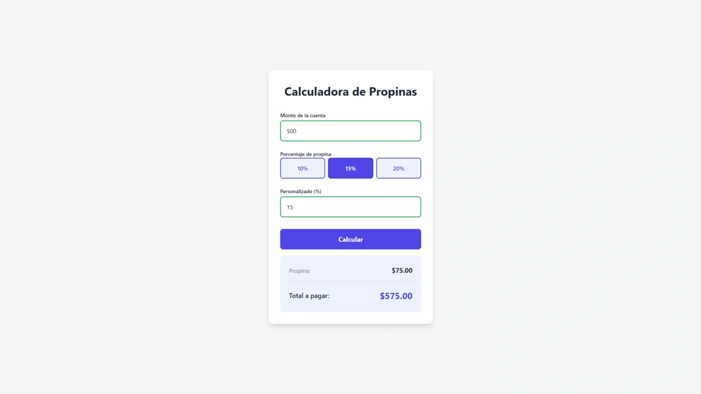

# 💸 SmartTip Calculator (Calculadora de Propinas)

Una calculadora de propinas ultrarrápida y sin dependencias, construida con **JavaScript Vanilla (ES6+)**. Cuenta con cálculo en tiempo real, validación estricta de inputs y un diseño totalmente responsivo.

> **🤖 Desarrollo Asistido por IA:** Este proyecto fue desarrollado utilizando un flujo de trabajo personalizado *Human-in-the-Loop*. Revisa el archivo [AI_WORKFLOW.md](./AI_WORKFLOW.md) para ver cómo orquesté agentes de IA para construirlo manteniendo estándares de ingeniería.

## ✨ Características
- ⚡ **Cálculo en Tiempo Real:** Calcula propinas al instante al seleccionar porcentajes predefinidos (10%, 15%, 20%) o ingresar uno personalizado.
- 🛡️ **Validación Estricta:** Previene números negativos, valores en cero y caracteres no numéricos sin usar ventanas emergentes (`alert()`) intrusivas.
- 📱 **Diseño Responsivo:** Se adapta perfectamente a escritorio, tablet y dispositivos móviles.
- 🎨 **CSS Moderno:** Utiliza Variables CSS para un mantenimiento sencillo y consistencia visual.
- 🚀 **Cero Dependencias:** 100% HTML5, CSS3 y Vanilla JS. Sin frameworks ni librerías innecesarias.

## 🚀 Cómo ejecutarlo
Al ser un proyecto front-end puro, ¡no se requieren herramientas de compilación ni instalaciones!
1. Clona este repositorio.
2. Abre el archivo `index.html` en cualquier navegador web moderno.
3. ¡Comienza a calcular!

## 🛠️ Tecnologías Utilizadas
- **HTML5** (Estructura semántica y accesibilidad)
- **CSS3** (Flexbox, Variables CSS, Diseño Responsivo)
- **JavaScript ES6+** (Arrow functions, `const`/`let`, template literals, manipulación del DOM)

## 📜 Historial de Cambios
Consulta el archivo [CHANGELOG.md](./CHANGELOG.md) para ver el historial de versiones y actualizaciones.

## 📄 Licencia
Este proyecto está bajo la Licencia MIT. Consulta el archivo [LICENSE](./LICENSE) para más detalles.